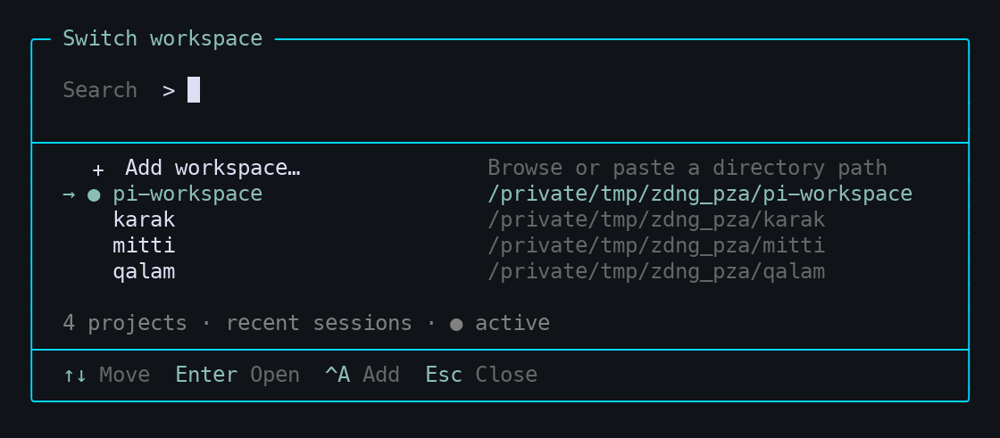
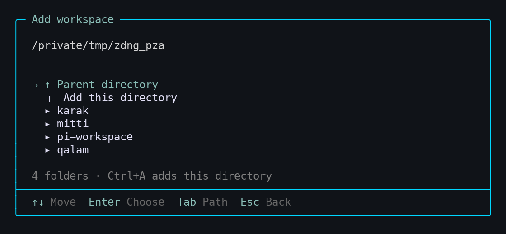

<div align="center">

# Pi Workspace

### Your projects. One Pi.

**Switch projects and pick up the conversation—without another terminal tab.**

[](https://github.com/earendil-works/pi)
[](#current-scope)
[](LICENSE)

[Quick start](#quick-start) · [Keyboard shortcuts](#keyboard-shortcuts) · [Add a project](#add-a-project) · [Development](#development)

</div>



<p align="center"><kbd>Ctrl</kbd> + <kbd>X</kbd> → find your project → <kbd>Enter</kbd> → continue working.</p>

## Less switching. More building.

You already have a conversation in one repository and work waiting in another. Pi Workspace brings those projects into one searchable list, right inside [Pi](https://github.com/earendil-works/pi).

| Find it | Resume it | Stay out of the way |
| --- | --- | --- |
| Fuzzy-search project names and paths. | Open a project's latest modified saved session with its working directory. | A small footer shows the active project. The picker disappears when you're done. |

**No Pi fork. No permanent sidebar. No slash command to remember.**

## Quick start

Install globally so the extension stays available when you change projects:

```sh
pi install git:github.com/grandimam/pi-workspace
```

Then run **`/reload`** in an existing Pi session, or start `pi`.

1. Look for the active-project indicator: `● pi-workspace · Ctrl+X`.
2. Press **Ctrl+X** and type a project name.
3. Press **Enter** to resume its saved session.

> **Preview compatibility:** tested on macOS with `@earendil-works/pi-coding-agent` **0.80.6** and Node.js **22.23.2**. Requires Node.js **22.19+**. Older Pi versions are unsupported; Linux terminal behavior has not yet been verified.

<details>
<summary><strong>Installing from a local checkout?</strong></summary>

```sh
git clone https://github.com/grandimam/pi-workspace.git
pi install ./pi-workspace
```

Or point Pi at a checkout you already have:

```sh
pi install /absolute/path/to/pi-workspace
```

No build step is required. Pi loads the TypeScript extension directly. Use a global installation, not `pi install -l`. Git installation uses the code pushed to the repository; local edits are available immediately through a local-path installation after `/reload`.

</details>

## Add a project

**Browse to it. You don't have to type the path.**



1. Open the picker with **Ctrl+X**.
2. Choose **＋ Add workspace…** at the top, or press **Ctrl+A**.
3. Browse folders with **↑ / ↓** and **Enter**.
4. Choose **＋ Add this directory** to save it.

Prefer pasting a path? Press **Tab** to edit it, then **Tab** again for directory completion. Relative paths and `~/` work too.

- Starts in the active project's parent directory—handy for sibling repositories.
- Accepts any accessible directory, not just Git repositories.
- Remembers registered projects across restarts and deduplicates symlink aliases.
- Returns to the picker with the added project selected. **Adding never switches your project unexpectedly.**

> **New project with no Pi session?** You can register it, but it will show **No session yet**. Start Pi in that directory and save a conversation first. Creating the first session in another directory from the picker is not implemented yet.

<sub>Screenshots are cropped captures of actual Pi terminal output, rendered to PNG using isolated demo directories—not private user sessions.</sub>

## Keyboard shortcuts

| Where | Key | Action |
| --- | --- | --- |
| Pi editor | **Ctrl+X** | Open the workspace picker |
| Picker | **Type** | Fuzzy-search names and paths |
| Picker / browser | **↑ / ↓** | Move selection |
| Picker / browser | **Page Up / Down** | Navigate longer lists |
| Picker | **Enter** | Open the selected project; selecting the active one closes the picker |
| Picker | **Ctrl+A** | Add a workspace |
| Browser | **Enter** | Open the selected folder or choose the Add action |
| Browser | **Ctrl+A** | Register the current directory |
| Browser | **Tab** | Edit a path; in path-edit mode, complete directory names |
| Path input | **Enter** | Browse the entered path—does not register it |
| Dialogs | **Esc** | Go back one step; close from the picker |
| Dialogs | **Ctrl+X** | Close the whole dialog |

**Alt+W** also opens/closes the picker if your terminal sends Alt/Option as Meta. On macOS, **Ctrl+X** avoids Option-key configuration issues.

## What appears in the picker?

The list combines **saved Pi sessions**, **manually registered directories**, and **your current directory**.

- **＋ Add workspace…** comes first, with the first project selected by default for quick switching.
- **●** marks the active project. Other projects follow their latest session modification time.
- Selecting a project resumes its **most recently modified saved session**.
- Names and full paths distinguish repositories with the same name.
- The list refreshes when you open the picker. Missing directories are omitted.

Pi remains the source of truth for conversation history. Workspace registration stores paths, not copied chats.

## Current scope

This is a small, extension-only preview focused on navigating existing project sessions.

**Available:** searchable switching, active-project footer, directory browsing, path completion, persistent manual registration.

**Not yet:** automatic Git discovery, a session chooser, first-session creation in another directory, registration-removal UI, or automatic restoration of the last workspace when launching Pi. Custom session directories outside Pi's default index are not enumerated.

### Switching safely

- Agent activity, pending messages, and unsent editor drafts block switching. Submit or clear your draft first.
- Switching uses Pi's session-replacement API and verifies the runtime, session, and prompt directories. It does not emulate a switch with `process.chdir()`.
- Do not switch during manually launched shell/background operations. Full execution-safety coverage beyond Pi's public idle/pending-message checks is not established.
- Pi 0.80.6 can exit if replacement-runtime initialization fails; automatic rollback is not available.
- Global credentials and trusted extension permissions remain governed by Pi. This extension is **not a sandbox**.

<details>
<summary><strong>Storage and troubleshooting</strong></summary>

Registrations live in `workspaces.json` under Pi's agent directory: `~/.pi/agent` by default, respecting `PI_CODING_AGENT_DIR`.

Writes use atomic replacement and a cross-process lock. Invalid registry data is reported rather than overwritten. A forcibly terminated write may leave `workspaces.json.lock`; remove it only after confirming no Pi instance is writing.

Missing directories remain registered on disk and reappear when accessible again. Registration never modifies repository contents or copies sessions.

The picker routes your Enter key through Pi's normal command pipeline using an internal `/workspace-open` command. You do not type it, and it is not sent to the model.

</details>

## Development

```sh
npm install
npm run check
npm test
```

Run the real-terminal smoke test with Pi on `PATH` and Python 3 installed:

```sh
python3 tests/tui-smoke.py
```

It uses temporary sessions and no model calls to check searchable switching, draft protection, A → B → A restoration, directory browsing, and explicit registration. It does not establish full filesystem-tool or project-resource isolation; see the [feasibility assessment](docs/feasibility.md).

Regenerate the README screenshots with [uv](https://docs.astral.sh/uv/):

```sh
uv run scripts/capture-screenshots.py
```

The script captures the real extension in a pseudo-terminal using sample projects, then rasterizes the terminal cells. It uses isolated agent storage and never opens your existing sessions. Set `PI_SCREENSHOT_FONT` to a monospace font file if one is not detected.

<details>
<summary><strong>Packaging and distribution</strong></summary>

The `pi.extensions` manifest supports local-path, Git, and npm distribution. Pi supplies the runtime peer packages; they are not bundled. Source, screenshots, README, and license are included in the npm package.

```sh
npm pack --dry-run
```

No npm release has been published by these changes. Before publishing, check package-name availability and run the tests. Git installs only receive local changes after they are committed and pushed.

</details>

## Uninstall

Use the same source you installed:

```sh
pi remove git:github.com/grandimam/pi-workspace
# Or, for a local installation:
pi remove /absolute/path/to/pi-workspace
```

Reload Pi afterward. Your projects and Pi sessions are untouched.

---

[MIT](LICENSE) · Built for developers who work across repositories, not terminal tabs.
